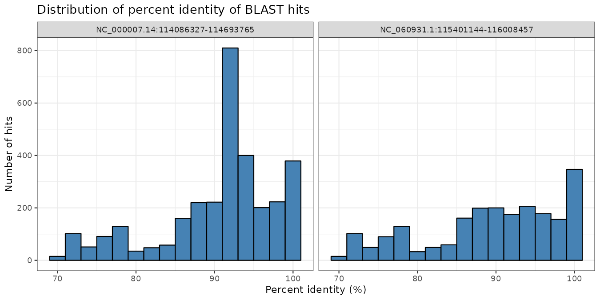
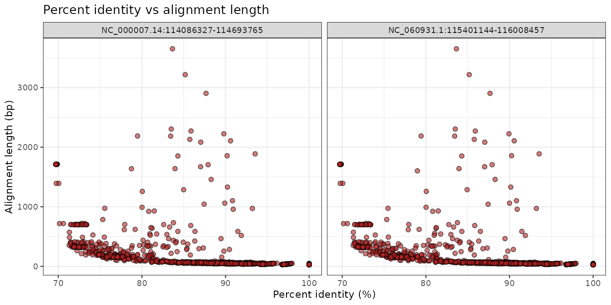

# BLAST pipeline: human *FOXP2* against the mouse genome

A small, reproducible bioinformatics pipeline that aligns the human *FOXP2* locus against the mouse reference genome with BLAST, then parses, filters and summarises the hits in Python and plots them in R.

Developed as the final project of *Fundamentals of Programming and Bioinformatics* (MSc in Computational Biology, Universidad Politécnica de Madrid).

## Pipeline

```
human_foxp2.fasta ─┐
                   ├─► blast_gene_to_genome.sh ─► parsing_blast.py ─► blast_visualizations.R
mouse_genome.fasta ┘        (makeblastdb +            (format, filter,      (ggplot2 plots)
                             blastn, outfmt 6)         statistics)
```

| Step | Script | Language | What it does |
|---|---|---|---|
| 1 | `scripts/blast_gene_to_genome.sh` | Bash | Builds the BLAST database (only if missing) and runs `blastn` |
| 2 | `scripts/parsing_blast.py` | Python | Reads the tabular output, writes a table with headers, filters hits by alignment length, % identity and e-value, and computes per-query statistics |
| 3 | `scripts/blast_visualizations.R` | R | Plots the % identity distribution and % identity vs alignment length |
| — | `scripts/blast_pipeline.sh` | Bash | Runs the three steps end to end and keeps logs |

## Installation

```bash
conda env create -f environment.yml   # or: mamba env create -f environment.yml
conda activate blast_foxp2
```

## Usage

1. Download the input FASTA files into `data/` (see [data/README.md](data/README.md)).
2. Run the pipeline:

```bash
./scripts/blast_pipeline.sh data/human_foxp2.fasta data/mouse_genome.fasta . 1000 90 0.01
```

Arguments: `<query.fasta> <genome.fasta> <out_dir> <min_alignment_length> [min_%identity=90] [max_evalue=0.01]`

Outputs are written to `<out_dir>/results/` and logs to `<out_dir>/logs/`.

## Results

The query contains the *FOXP2* locus (~607 kb) from two human assemblies (GRCh38 and T2T-CHM13). BLAST returned 3,144 and 2,148 hits respectively across the mouse genome ([full statistics](results/blast_statistics.tsv)).

After filtering (alignment ≥ 1,000 bp, identity > 90 %, e-value ≤ 0.01), the **10 remaining hits all fall on mouse chromosome 6 (`NC_000072.7`)**, where the mouse ortholog *Foxp2* is located, with identities of 90–94 % ([filtered hits](results/blast_filtered.tsv)). Both human assemblies give practically identical results.





## Repository structure

```
.
├── data/                 # input FASTA files (not tracked, see data/README.md)
├── results/
│   ├── blast_filtered.tsv
│   ├── blast_statistics.tsv
│   └── figures/
├── scripts/
│   ├── blast_pipeline.sh
│   ├── blast_gene_to_genome.sh
│   ├── parsing_blast.py
│   └── blast_visualizations.R
└── environment.yml
```

## Author

Juan Benítez Humanes
